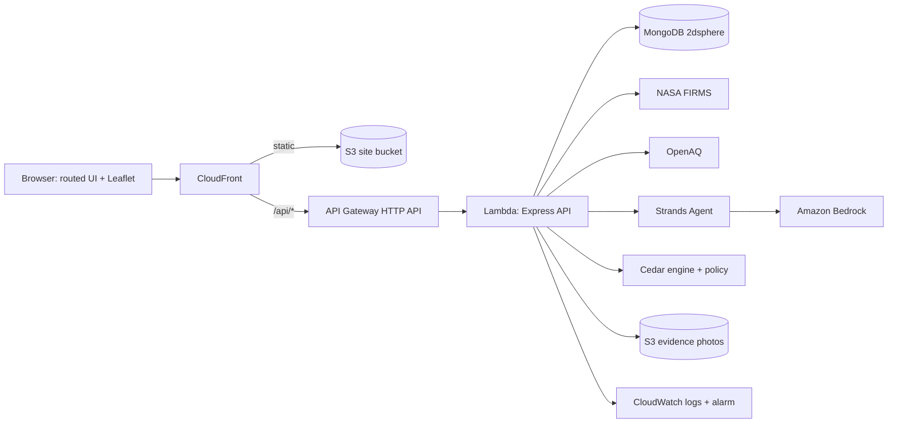

<p align="center"></p>

# AeroSentinel — Hyperlocal Stubble-Burning Verification & Response
*Track 01 — Air*

> **AI recommends. Cedar decides. Humans remain in the loop for verification.**

**One-line pitch:** AeroSentinel turns fragmented smoke signals into a verified, policy-controlled public advisory.

## The decision problem (not "another AQI dashboard")
Authorities may see a satellite hotspot, a worsening AQI, or a citizen report, but **no single signal justifies an advisory**. AeroSentinel answers one question:

> *Is this suspected agricultural-burning incident sufficiently corroborated, who nearby may be exposed, and is an advisory allowed to be issued?*


`DETECT → FUSE → VERIFY → ASSESS → RECOMMEND → AUTHORIZE → ADVISE`

| Signal | Role |
|---|---|
| Satellite hotspot (NASA FIRMS) | possible hotspot evidence, not proof |
| Ground AQI (OpenAQ) | supporting environmental context |
| Community report | corroboration |
| Human reviewer | verification authority |
| Strands agent (Bedrock) | drafts a recommendation only |
| Cedar policy | decides whether an advisory may be issued |

**Evidence Score** (max 100, a transparent heuristic, *not* a probability): satellite 40 + ground AQI 30 + community 20 + recency 10.
**Cedar rule** (`aws/cedar/advisory.cedar`): allow only if `status == VERIFIED` and `exposure == HIGH` and `evidenceScore >= threshold`.

## Quick start (Windows 11 / PowerShell, Node 22.9+)
```powershell
cd AeroSentinel
npm install
npm start          # http://localhost:3000
npm test           # scripted end-to-end API check, expects: HIGH ALLOW ISSUED
```
Optional: `Copy-Item .env.example .env` and edit (loaded automatically). No credentials are needed for demo mode.

## Architecture

Local development runs the same Express app directly (`server/`), serving the UI from `public/`.

## What is real, and what is not (honest status)
| Area | Status |
|---|---|
| Workflow, states, evidence score, exposure, UI pages | Working; tested via scripted API run and a jsdom smoke test (not a real browser) |
| Cedar | Real engine (`@cedar-policy/cedar-wasm`), allow and deny paths tested |
| Strands + Bedrock | Real SDK (`@strands-agents/sdk` 1.x, experimental) wired in; **not tested against live Bedrock** (needs credentials). Falls back to a labelled rule-based adapter |
| NASA FIRMS / OpenAQ live mode | URL formats checked against docs; tested with mocked responses only; OpenAQ field names assumed |
| MongoDB | Models + 2dsphere + `$near`; **not tested against a real MongoDB**; unreachable-DB fallback tested |
| SAM template | Passes cfn-lint; **never deployed** |
| Not built | React/Vite frontend, split Evidence/Advisory/etc. collections, photo viewing, auth, tests beyond smoke/self-test |

Demo data is always labelled DEMO. Deployed Lambda needs `MongoDbUri` for state to persist.

## Configuration (`.env`)
`DATA_MODE` (DEMO/LIVE), `EVIDENCE_THRESHOLD`, `REGION_BBOX`, `FIRMS_MAP_KEY`, `OPENAQ_API_KEY`, `MONGODB_URI`, `BEDROCK_MODEL_ID`, `AWS_REGION`, `S3_BUCKET`. See `.env.example`. Secrets are never sent to the browser.
- **Live data:** free keys from NASA FIRMS (`firms.modaps.eosdis.nasa.gov/api/map_key`) and OpenAQ (`explore.openaq.org`). Any provider failure falls back to labelled DEMO. *Sync live data* only creates incidents from real hotspots.
- **MongoDB:** `MONGODB_URI=mongodb://127.0.0.1:27017/aerosentinel`; seeds demo data on first start.
- **Bedrock:** needs AWS credentials (`aws configure`), model access in your region, and `BEDROCK_MODEL_ID` set to a model or inference profile you can use. The agent sees only structured facts and returns validated JSON.
- **S3 photos:** `S3_BUCKET` + `npm i @aws-sdk/client-s3`.

## AWS deployment (SAM)
```powershell
npm run build:lambda
cd infrastructure
sam build
sam deploy --guided
cd ..
npm run deploy:site -- <SiteBucketName> <DistributionId>   # stack outputs
```
Resources and why: S3 + CloudFront (private static hosting, `/api/*` routed to API), HTTP API + Lambda (serverless API), S3 evidence bucket (encrypted, 90-day expiry), IAM limited to `PutObject` on `reports/*` and Bedrock invoke (narrow the Bedrock resource to your model), CloudWatch logs and an error alarm. Bedrock powers the agent, Strands structures it, Cedar governs the final action.

## 3-minute demo (click **RUN DEMO SCENARIO** to automate steps 3–6)
1. **0:00** Dashboard: say "a hotspot alone proves nothing". Point at the suspected incident and LIVE/DEMO labels.
2. **0:20** Open INC-001: satellite + AQI 287 + community report on the evidence timeline.
3. **0:50** Evidence Score 100/100 ("a heuristic, not a probability").
4. **1:00** *Review & verify* → **VERIFY INCIDENT** (human in the loop).
5. **1:20** *Assess nearby exposure*: school 1.17 km, residential 2.34 km, road 2.86 km → **HIGH**.
6. **1:40** **GENERATE ADVISORY**: AI recommendation READY (note the mode label).
7. **2:20** **Run Cedar policy** → ALLOWED → advisory ISSUED; open the public advisory.
8. **2:35** Show INC-004 (verified but LOW exposure): Cedar **BLOCKED**. Same pipeline, different outcome.
9. **2:45** Open the Architecture page (`#/architecture`). Close: *"AeroSentinel does not treat a single signal as truth. It turns fragmented environmental evidence into a verified, policy-controlled response."*

Tip: run locally for the recording (state persists in memory for the session); click RUN DEMO SCENARIO again to reset.

## API
`GET /api/health` · `GET /api/status` · `GET /api/incidents` · `GET /api/incidents/nearby?lat&lng&radiusKm` · `GET /api/incidents/:id` · `POST /api/incidents` · `PATCH /api/incidents/:id/verify` (`VERIFY|REJECT|MORE_EVIDENCE` + `reason`) · `POST /api/incidents/:id/exposure` · `POST /api/incidents/:id/advisory` · `POST /api/incidents/:id/policy-check` · `GET /api/hotspots` · `GET /api/aqi` · `POST /api/reports` · `POST /api/live/sync` · `POST /api/reset`.
Invalid input returns 400/409/413 with `{ "error": "..." }`; internals are never leaked. CORS is same-origin unless `CORS_ORIGIN` is set.

## UI and map notes
- Basemap: CARTO "Dark Matter" tiles (© OpenStreetMap contributors © CARTO, attribution shown on the map), with automatic fallback to OpenStreetMap standard tiles, then an honest on-map message if neither loads. CARTO's free basemaps are intended for non-commercial/low-volume use; review their terms before production and consider a keyed provider.
- The earlier OpenStreetMap HTTP 403 was most likely caused by the app's own `Referrer-Policy: no-referrer` header (OSM requires a Referer). It is now `strict-origin-when-cross-origin`.
- `/api/status` now also returns `integrations` (what is configured, not what has answered a request); the Status page shows it next to the LIVE/DEMO/UNAVAILABLE/STALE data-source states.

## UI redesign (ivory / orange / lime)
Light editorial workspace: top navigation, map-first overview with a metrics strip and filter chips, an incident investigation page with a horizontal workflow timeline (states are computed from real incident data: completed, current, pending, failed), compact evidence / reviewer / exposure / AI sections, and a confirmation dialog for every reviewer decision.
- **Decision history is now persisted.** `PATCH /api/incidents/:id/verify` accepts `{ action, reason }` (reason required for `REJECT` and `MORE_EVIDENCE`, max 300 chars) and appends `{ action, status, reason, reviewer, decidedAt }` to `incident.decisions` (also in the MongoDB schema). There is no authentication, so the reviewer is recorded as "Local reviewer (no authentication in this build)". Seeded incidents start with no history.
- Exposure values carry provenance pills (calculated / simulated / sourced / measured). Wind, affected area and population are shown as "not available" because no weather or population source exists; nothing is invented.
- The frontend is plain JavaScript (no React) by design of this repository; it was not migrated.

## Responsible AI
Satellite hotspot ≠ proof of burning · evidence score ≠ probability · exposure ≠ medical diagnosis · the AI never verifies or issues · humans verify · the system never accuses individuals · data provenance and DEMO/LIVE status are always shown.

## Limitations and future work
Single region, indicative exposure heuristics, no authentication, no real-browser or load testing, in-memory fallback state, no forecasting. Next: React/Vite UI, authenticated reviewer roles, DynamoDB/Mongo-backed audit log of verification and policy decisions, FIRMS multi-day trend, SMS/Public alert channels.
